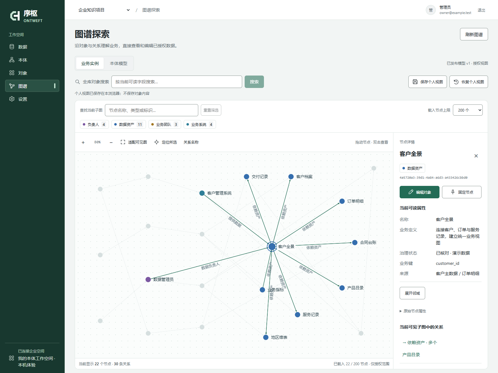
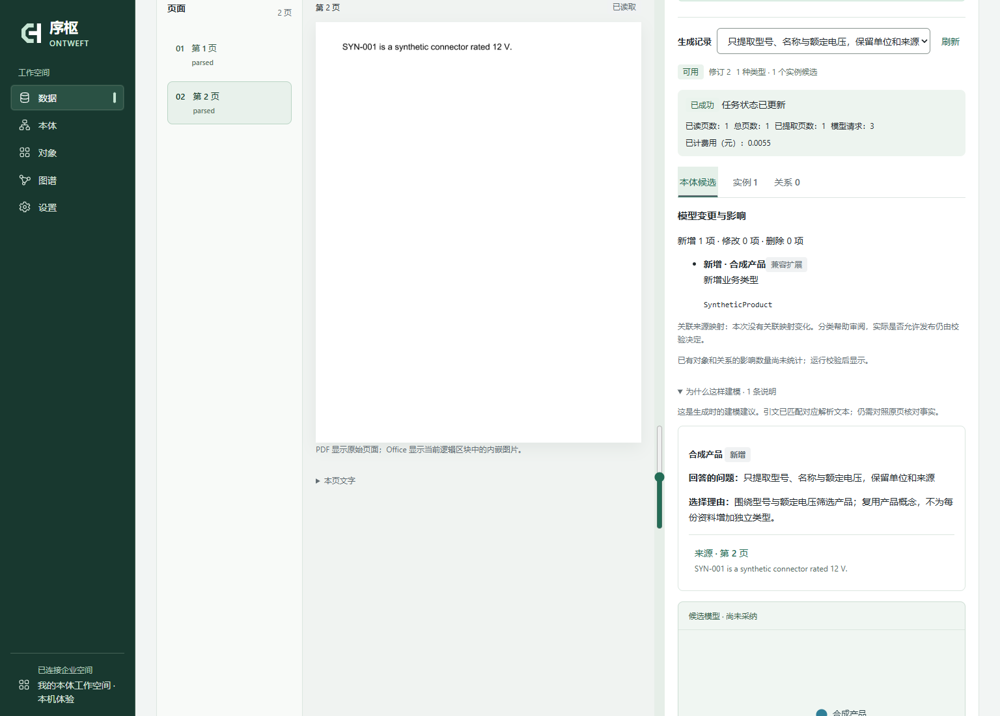

<p align="center"></p>
<h1 align="center">Ontweft · 序枢</h1>
<p align="center"><strong>Turn product documents and business tables into a traceable knowledge graph.</strong><br />Filter products, inspect inventory and applicability, then open the source behind each conclusion.</p>
<p align="center">Self-hosted · AI-assisted ontology modeling · Apache-2.0<br /><a href="README.md">简体中文</a> · English</p>
<p align="center"><a href="#run-the-product-example">Run the product example</a> · <a href="https://github.com/xiaohuihuiaijia/ontweft/releases/download/v0.1.0-beta.1/ontweft-first-experience.mp4">Watch the walkthrough</a> · <a href="#bring-your-own-data">Bring your own data</a></p>



<p align="center"><sub>Real application and API with synthetic products, inventory and conditions. Drag to arrange the view; open objects or relationships to inspect properties and evidence. No customer data.</sub></p>

Specifications describe a product. Inventory tells you where it is available. A manual explains when it can be used. Ontweft connects these into editable business objects and relationships, so an answer can be inspected rather than just accepted.

An **ontology** defines their shared types, fields and relationships. A **knowledge graph** contains the actual products, stock records and connections. You can try the example before learning all the terminology.

## Run the product example

Requires Docker using Linux containers. The preview release is **[v0.1.0-beta.1](https://github.com/xiaohuihuiaijia/ontweft/releases/tag/v0.1.0-beta.1)**. Initial release validation covers `linux/amd64`; other architectures have not been verified.

```sh
docker run --rm -it -p 127.0.0.1:8020:8020 -v ontweft-experience:/data ghcr.io/xiaohuihuiaijia/ontweft:0.1.0-beta.1-demo
```

Set a local password when prompted and sign in as `owner` at the URL printed in the terminal (default **http://127.0.0.1:8020**). The launcher prints a direct link to the example graph. You can also select **产品与库存 · 合成样例** (Product and inventory · synthetic example) in the **项目** project selector at the top.

The experience includes a separate synthetic example project and an empty project. **No model API key is needed.** The example is not a live AI generation, and ordinary new projects are not populated with demonstration data.

The interface currently uses Chinese labels; the labels below match what you will see. All quantities and conditions in this example are synthetic.

1. **Products and inventory:** open **Graph（图谱）**, whose page title is **图谱探索**. In **节点列表（键盘可操作）** (node list), select **SYN-04 · 4 芯** (4-pin product). In its details, follow **华东仓 · A01** (East China warehouse A01) to see **40** units, then select **SYN-04 · 4 芯** to return to the product.
2. **Relationship conditions:** in the product details, click **适用场景** (applicability relationship) beside **室内传感采集** (indoor sensor acquisition). Check the **24 V** limit and indoor dry-environment condition in **关系条件与证据** (relationship conditions and evidence). These conditions belong to this relationship, not to every use of the product.
3. **Evidence and edits:** choose **查看固定来源版本** (open the fixed source version), read the supporting statement, then **关闭侧栏** (close the source panel). Choose **编辑条件与证据** (edit conditions and evidence), update **适用条件** (condition), add **修改说明** (change note), and click **保存关系条件** (save). Expand **关系修订历史** (revision history) to compare the saved condition with its previous value.

Stop with `Ctrl+C`. Data remains in the `ontweft-experience` volume and is reused on the next run. This image is for local evaluation and publishes only to the loopback address. See the [deployment guide](docs/deployment.md) for team deployment, backup and upgrades. The UI and detailed guides are primarily Chinese.

## Bring your own data

Switch to the empty project, then choose a starting point. Keep real business data out of screenshots you intend to share.

| Your input | Where to start | Result |
| --- | --- | --- |
| CSV / XLSX tables | Data（数据）→ 数据源 tab → 上传并查看数据 (upload and inspect) → confirm fields and business keys → publish the model → import | Searchable objects, source records and a versioned update path; no AI key required |
| PostgreSQL | Configure allowed source hosts first, then Data（数据）→ 数据源 tab → 登记数据源 (register a read-only connection) → discover resources → review mappings → publish and ingest | Deterministic object ingestion with explicit identity and update rules; no model call per row |
| PDF, Office, images or text | Settings（设置）→ 模型连接 (model connections); then Data（数据）→ 文档资料 (documents), or Ontology（本体）→ AI 起草本体 → 起草新模型 (draft a model) | Evidence-linked type, property, relationship and instance candidates for review before publishing and importing |

Start with one table and one question: which products meet these requirements, where are they stocked, and what supports their applicability? See [data-to-ontology](docs/data-to-ontology.md) and [getting started](docs/getting-started.md).

The experience image does not allow external database hosts by default. Configure the allowed source hosts as described in the [deployment guide](docs/deployment.md) before connecting PostgreSQL. Uploading local tables does not need this configuration.

## From suggestions to verifiable business facts

| Workflow | What you can do |
| --- | --- |
| **Understand documents** | Read PDFs, Office files, images and text; extract from a selected scope automatically or against your own requirements; open the supporting source |
| **Draft an ontology** | Start from business questions; review reuse decisions, source evidence and model differences before validating, approving and publishing |
| **Bring in data** | CSV/XLSX and PostgreSQL; explicit business keys, immutable file versions, mappings and exact cross-source identity binding |
| **Maintain relationships** | Express applicability as relationship properties, retain conflicting candidates for review and record property history; incremental rules preserve manual and source support |
| **Work in the graph** | Authorized global search, paginated neighbors, drag and pin, saved personal views; edit objects or relationships and trace their source evidence |
| **Collaborate** | Project and field permissions, model revisions, versioned evidence and audit records; separate model author and approver in enterprise mode |

The product example is a starting point; the same model can describe customers, orders and other business objects. Knowledge management preserves concepts, versions and sources. The optional knowledge base extension provides pages, full-text search and evidence links, rather than a turnkey Q&A chatbot.

Five main destinations: **Data（数据）, Ontology（本体）, Objects（对象）, Graph（图谱）, Settings（设置）**. One PostgreSQL database, one API service and the existing worker. No separate graph or vector service required. Manual modeling and deterministic ingestion work without an AI key; additional connectors, knowledge and automation remain optional.

## Source development

<details>
<summary>Run an empty workspace from source (developer path)</summary>

Install **Python 3.12, uv and Node.js 22.12+**, then run:

```sh
git clone https://github.com/xiaohuihuiaijia/ontweft.git
cd ontweft
uv sync --locked --no-dev
npm --prefix frontend ci
npm --prefix frontend run build
uv run --locked --no-dev python scripts/start_local_demo.py
```

Choose a password of at least 12 characters at the hidden prompt. Open **http://127.0.0.1:8020** and sign in as `owner`.

- **Explore the graph:** create a change set from a template in Ontology（本体）, edit and publish it, add records in Objects（对象）, then drag and edit them in Graph（图谱）.
- **Use your own tables:** start the worker below in another terminal, upload CSV/XLSX in Data（数据）, choose business keys and generate editable model suggestions.
- **Try AI drafting:** configure a compatible service under Settings（设置）→ 模型连接, then select sources, scope and an optional business goal from Data（数据）→ 文档资料 or Ontology（本体）→ AI 起草本体 → 起草新模型.

```sh
uv run --locked --no-dev python scripts/start_local_demo.py worker
```

The local demo uses persistent SQLite in `var/local-demo/` and binds only to loopback. Team deployments use PostgreSQL and HTTPS. See the [deployment guide](docs/deployment.md).

This source path keeps the project empty; it does not automatically load the product example above.

</details>

## AI proposes. You decide what becomes a fact.



<p align="center"><sub>Synthetic material and locally controlled model responses in the real review interface. No customer data; this is not a model-quality benchmark.</sub></p>

Review **why a concept belongs in the model** before adopting it. Modeling notes connect business questions to reuse or creation decisions and selected source material. Suggestions without matching evidence are flagged for review. Object and relationship candidates use field-aware editors; import results distinguish completed and blocked records rather than hiding conflicts behind a success message.

AI proposals and manual change sets share the same model diff: display changes, compatible additions and changes requiring data review. Impact counts come from the validation scan and stay unknown until measured. Type aliases help discovery; they do not merge objects.

The integration uses configurable OpenAI-compatible Chat Completions. Text, vision and structured-output capabilities are declared and tested separately. Bailian is the first live-tested service; interface compatibility does not imply that other providers have been verified.

PDF pages render locally with native text extraction; configured vision models interpret table structure and complex pages. Office files and spreadsheets retain directly readable structure. Inputs include PDF, DOCX, XLSX, PPTX, PNG/JPEG, CSV, text and Markdown. Office page numbers denote logical units. Document uploads default to **256 MiB**; deterministic table imports have separate [size and structure limits](docs/data-to-ontology.md).

Page progress and evidence versions remain traceable. Changing the business goal can reuse base recognition results. Candidates are editable; models cannot run arbitrary SQL, publish definitions directly or bypass import confirmation. **No standalone OCR engine, GPU or resident local model service is required. Configured external models incur provider charges.**

## What has been verified

Checks include isolated database regressions, real Chromium workflows, Linux/PostgreSQL CI and synthetic deployment/restore exercises. Ongoing fixes address reproduced failures in sequential file updates, source withdrawal previews, relationship matching, stale form state, model usage accounting and list queries. See the [audit](docs/project-audit.md) and [current CI](https://github.com/xiaohuihuiaijia/ontweft/actions/workflows/ci.yml).

A synthetic benchmark covers **100,000 objects / 1,000,000 relationships / 50 users**. Unique-code search P95 still exceeds the one-second target; this is not a production SLA. Human-verified document accuracy, full-document processing, live CDC failure recovery and large-attachment disaster recovery still need dedicated acceptance tests. [Measurements and limits →](docs/beta-verification.md)

## Documentation and contributions

| Goal | Guide |
| --- | --- |
| Build your first ontology | [Getting started](docs/getting-started.md) · [Data to ontology](docs/data-to-ontology.md) |
| Understand models and graphs | [Methodology](docs/ontology-methodology.md) · [Graph operations](docs/graph.md) |
| Deploy, upgrade and extend | [Deployment](docs/deployment.md) · [Core and extensions](docs/enterprise-beta.md) |
| Review or contribute | [Contributing](CONTRIBUTING.md) · [Audit and open decisions](docs/project-audit.md) |

**Python / FastAPI / SQLAlchemy / PostgreSQL · React / TypeScript / Sigma / Graphology.** A modular monolith shaped by concrete use cases.

If this direction is useful to you, **Star** the project to bookmark it or show support. To receive release notifications, choose **Watch → Custom → Releases**. [Share trial feedback](https://github.com/xiaohuihuiaijia/ontweft/issues/new?template=first-experience.yml): your business question, the last step you reached, and whether you could inspect objects, relationships and evidence. Actual trials and specific feedback help us improve more than a number. [First-user plan](docs/first-users.md)

Use sanitized or synthetic examples. Report security issues privately under the [security policy](SECURITY.md). This is **Enterprise Beta**, with a primarily Chinese UI, intended for evaluating a specific business use case.

Project-owned code is [Apache-2.0](LICENSE). Third-party components retain their licenses and [notices](frontend/public/THIRD_PARTY_NOTICES.txt); see [screenshot provenance](docs/images/README.md) and [NOTICE](NOTICE). No claim of production readiness, a complete security audit, trademark clearance or complete binary/model redistribution clearance is made.
