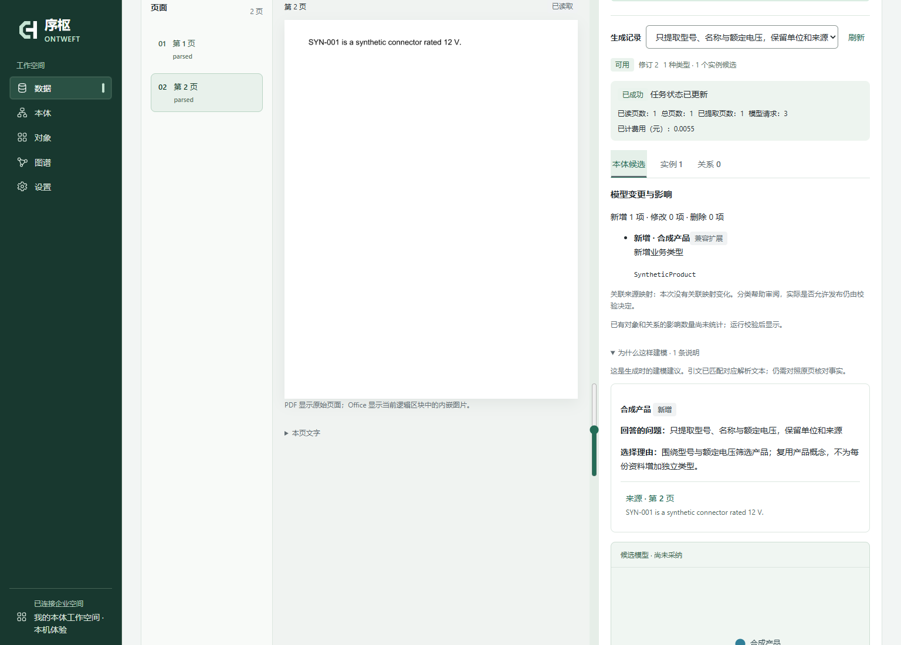

<p align="center"></p>
<h1 align="center">序枢 Ontweft</h1>
<p align="center"><strong>把产品资料和业务表，变成能核对来源的知识图谱。</strong><br />筛选型号、查看库存与适用条件，再回到每项结论的原文依据。</p>
<p align="center">自部署 · AI 辅助本体建模 · Apache-2.0<br />简体中文 · <a href="README.en.md">English</a></p>
<p align="center"><a href="#运行产品样例">运行产品样例</a> · <a href="https://github.com/xiaohuihuiaijia/ontweft/releases/download/v0.1.0-beta.1/ontweft-first-experience.mp4">观看实操视频</a> · <a href="#带自己的数据开始">带自己的数据开始</a></p>


<p align="center"><sub>真实应用与 API，合成产品、库存和适用条件。拖动整理视图，点击对象或关系核对属性与原文依据。非客户数据。</sub></p>

一张规格表告诉你产品参数，一张库存表告诉你哪里有货，一份手册解释适用条件。Ontweft 把它们连接成可编辑的业务对象与关系，让你既能找到答案，也能检查答案从哪里来。

**本体**是这些数据共同遵循的类型、字段和关系定义；**知识图谱**是定义下的具体产品、库存与关联。你不必先学完整套本体术语才能体验。

## 运行产品样例

需要 Docker，使用 Linux 容器。预发布体验版本为 **[v0.1.0-beta.1](https://github.com/xiaohuihuiaijia/ontweft/releases/tag/v0.1.0-beta.1)**；首批发行验证覆盖 `linux/amd64`，其他架构尚未验收。

```sh
docker run --rm -it -p 127.0.0.1:8020:8020 -v ontweft-experience:/data ghcr.io/xiaohuihuiaijia/ontweft:0.1.0-beta.1-demo
```

按终端提示设置本机密码，用 `owner` 登录终端给出的地址（默认 **http://127.0.0.1:8020**）。启动器会输出直接进入样例图谱的链接；也可在顶部项目选择器中切换到产品样例。

体验包含独立的合成样例项目与空白项目，**无需模型 Key**。样例不是实时 AI 生成结果；普通新项目不会自动填入演示数据。

1. **产品与库存**：在“对象”中按产品字段筛选，查看产品与库存的关联。
2. **关系条件**：进入“图谱”，选择一条适用关系，核对它的条件；可拖动、固定节点整理视图。
3. **证据与修改**：打开原文核对依据，修改允许编辑的条件后保存，再查看修订历史。

`Ctrl+C` 停止服务，数据保留在 `ontweft-experience` 卷中；再次运行复用该卷。该镜像用于本机体验，仅映射回环地址。团队部署、备份与升级见[部署指南](docs/deployment.md)。

## 带自己的数据开始

切换到保留的空白项目，再选择适合自己的起点。不要把真实资料混入准备分享的样例截图。

| 手头有什么 | 从哪里进入 | 得到什么 |
| --- | --- | --- |
| CSV / XLSX 业务表 | 数据 → 上传表格 → 确认字段与业务键 → 发布模型 → 导入 | 可查询的对象、来源记录和后续文件更新入口；无需 AI Key |
| PostgreSQL 数据库 | 按部署说明配置允许连接的来源主机后：数据 → 登记只读连接 → 发现资源 → 确认映射 → 发布、采集 | 按映射生成对象，明确身份和持续更新规则；不逐行调用模型 |
| PDF、Office、图片或文本 | 设置 → 模型连接；然后进入数据 → 文档资料或本体 → AI 起草 | 有来源的类型、属性、关系与实例候选，经编辑确认后发布、导入 |

首次可以只带一张表，回答一个具体问题，例如“哪些产品满足这些参数、库存在哪里、适用条件依据是什么”。完整步骤见[从数据建模](docs/data-to-ontology.md)与[入门指南](docs/getting-started.md)。

体验镜像默认不允许连接外部数据库主机。接入 PostgreSQL 前请按[部署指南](docs/deployment.md)配置来源主机允许范围；上传本地表格不需要这项配置。

## 从建议到可核对的业务事实

| 工作环节 | 你可以做什么 |
| --- | --- |
| **理解资料** | 读取 PDF、Office、图片与文本；按所选范围自动归纳，或按自定义业务要求提取；候选可跳回来源 |
| **起草本体** | 围绕业务问题起草类型、属性、关系和映射；审阅复用理由、材料依据和模型差异，再校验、审批与发布 |
| **接入数据** | CSV/XLSX 与 PostgreSQL；明确业务键、不可变文件版本、来源映射和精确跨来源绑定 |
| **维护关系** | 用关系属性表达适用条件；冲突保留待处理，属性修改保留历史；持续规则增量重算，保留人工及来源支持 |
| **在图谱中工作** | 授权全库搜索、按需展开邻域、拖动与固定节点、恢复个人视图；点击对象或关系编辑，回查原文证据 |
| **团队协作** | 项目与字段权限、模型修订、版本化证据和审计；企业模式默认异人模型审批 |

产品样例只是起点，同一模型也可描述客户、订单等业务对象。知识管理保留概念、版本与来源；知识库管理按需提供页面、全文检索及证据关联，不是开箱即用的问答机器人。

只有 **数据、本体、对象、图谱、设置** 五个主入口。核心是一套 PostgreSQL、一个 API 服务和现有 worker。无需额外图数据库或向量服务；手工建模和确定性采集无需 AI Key。非核心连接器、知识与自动化按需启用。

## 源码开发

<details>
<summary>从源码运行空白工作台（开发者路径）</summary>

准备 **Python 3.12、uv、Node.js 22.12+**，运行：

```sh
git clone https://github.com/xiaohuihuiaijia/ontweft.git
cd ontweft
uv sync --locked --no-dev
npm --prefix frontend ci
npm --prefix frontend run build
uv run --locked --no-dev python scripts/start_local_demo.py
```

首次运行设置至少 12 个字符的密码，终端不回显。打开 **http://127.0.0.1:8020**，使用 `owner` 登录。

- **先体验图谱：** 在“本体”选择模板并编辑、验证、发布，在“对象”添加记录，再进入“图谱”拖动与编辑。
- **从自己的数据开始：** 另开终端启动下面的 worker，从“数据”上传 CSV/XLSX，选择业务键并生成模型建议。
- **让 AI 辅助起草：** 在“设置 → 模型连接”配置兼容服务，在“数据 → 文档理解”或“本体 → AI 起草”选择材料、范围与业务要求。

```sh
uv run --locked --no-dev python scripts/start_local_demo.py worker
```

本机体验使用持久化 SQLite，数据保存在 `var/local-demo/`，仅监听回环地址。团队部署使用 PostgreSQL 与 HTTPS；见[部署指南](docs/deployment.md)。

此源码路径保留空白项目，不自动加载上面的产品样例。

</details>

## AI 提建议，业务事实由你确认



<p align="center"><sub>合成材料与本机受控模型响应，展示真实审阅界面；不是客户数据，也不代表模型质量验收。</sub></p>

先看**为什么需要这个概念**，再决定是否采纳。建模说明列出业务问题、复用或新增的理由以及材料依据；找不到依据的建议明确标记待复核。对象与关系候选按字段类型编辑，导入结果区分成功与待处理记录，不用一条“成功”隐藏冲突。

AI 提案和手工变更集使用同一份差异说明：哪些只是改名称或别名，哪些增加可选能力，哪些需要核对已有数据。影响数量来自实际校验扫描，未统计时保留未知；别名不会自动合并对象。

接入层使用可配置的 OpenAI-compatible Chat Completions，文字、视觉与结构化输出能力分别声明和测试。百炼是首个实测服务；不把接口兼容视作其他供应商已通过验证。

PDF 在本地分页渲染并提取原生文字，表格结构与复杂页面交给所配置的视觉模型；Office 和表格文件保留可直接读取的结构。支持 PDF、DOCX、XLSX、PPTX、PNG/JPEG、CSV、文本/Markdown；Office 页码是逻辑单元。文档上传默认 **256 MiB**，确定性表格导入另有[行列及大小预算](docs/data-to-ontology.md)。

页面进度与证据版本可追溯；修改业务要求可复用基础识别。模型产出进入可编辑候选，不能执行任意 SQL、直接发布模型或绕过实例导入确认。**无需独立 OCR、GPU 或常驻本地模型服务；配置外部模型后，调用按供应商计费。**

## 已验证什么

已运行隔离数据库回归、真实 Chromium 工作流、Linux/PostgreSQL CI，以及合成数据部署与恢复验证。持续修复围绕可复现问题：连续文件更新、来源撤回预览、关系匹配、表单状态、模型费用记账及列表读取，详见[项目审查](docs/project-audit.md)与[当前 CI](https://github.com/xiaohuihuiaijia/ontweft/actions/workflows/ci.yml)。

已有 **10 万对象 / 100 万关系 / 50 用户**的合成规模测量；唯一编码搜索 P95 仍高于 1 秒目标，不能据此宣称生产 SLA。复杂文档的人工准确率、整本处理、真实 CDC 故障恢复与大附件灾难恢复仍需专项验收。[完整测量与限制 →](docs/beta-verification.md)

## 文档与参与

| 想了解什么 | 入口 |
| --- | --- |
| 第一次建立本体 | [入门指南](docs/getting-started.md) · [从数据建模](docs/data-to-ontology.md) |
| 模型与图谱如何工作 | [本体方法论](docs/ontology-methodology.md) · [图谱操作](docs/graph.md) |
| 部署、升级与扩展 | [部署指南](docs/deployment.md) · [核心与扩展](docs/enterprise-beta.md) |
| 核对实现或提交代码 | [贡献指南](CONTRIBUTING.md) · [审查与待审核项](docs/project-audit.md) |

**Python / FastAPI / SQLAlchemy / PostgreSQL · React / TypeScript / Sigma / Graphology。** 保持模块化单体，优先解决具体场景，不建设额外的平台层。

如果这个方向对你有用，欢迎 **Star** 收藏或表示支持；希望收到版本更新，请选择 **Watch → Custom → Releases**。也请[提交试用反馈](https://github.com/xiaohuihuiaijia/ontweft/issues/new?template=first-experience.yml)：你想解决什么问题、运行到哪一步、是否成功看到对象、关系与证据。实际试用与具体反馈，比一个数字更能帮助我们改进。[首批使用者计划](docs/first-users.md)

反馈请使用脱敏或合成示例；安全问题按[安全说明](SECURITY.md)私下报告。当前为 **Enterprise Beta**，界面以中文为主，适合用具体业务场景评估。

自有代码采用 [Apache-2.0](LICENSE)，第三方组件保留原许可与[必要通知](frontend/public/THIRD_PARTY_NOTICES.txt)。[截图来源](docs/images/README.md)与 [NOTICE](NOTICE)随仓库提供。当前不宣称生产可用性、完整安全审计、商标清查或全部二进制/模型再分发验收通过。
