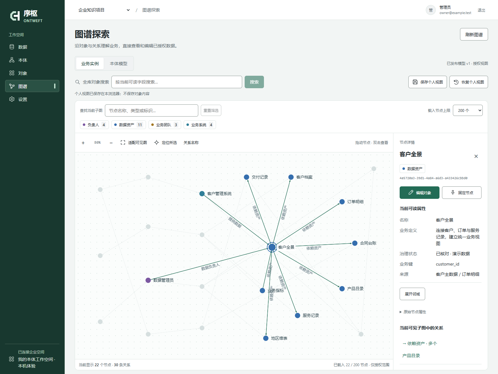

<p align="center">
  
</p>

<h1 align="center">序枢 Ontweft</h1>

<p align="center"><strong>让知识连接业务。</strong><br />把分散的数据，变成可理解、可编辑、持续更新的业务关系。</p>

<p align="center">开源企业本体工作台 · 自部署 · Apache-2.0</p>

<p align="center">
  简体中文 · <a href="README.en.md">English</a> ·
  <a href="#本机体验">开始使用</a> ·
  <a href="https://github.com/xiaohuihuiaijia/ontweft/blob/codex/slim-enterprise-beta/docs/deployment.md">部署文档</a> ·
  <a href="https://github.com/xiaohuihuiaijia/ontweft/issues">反馈与建议</a>
</p>



<p align="center"><sub>真实界面，22 个合成对象、30 条具名关系。可拖动节点、展开邻域，并从详情进入对象编辑。截图不是客户数据。</sub></p>

> **当前试用版本：企业 Beta 分支。** 本页展示 `codex/slim-enterprise-beta`，功能代码正在 [PR #1](https://github.com/xiaohuihuiaijia/ontweft/pull/1) 中审核；`main` 的应用代码仍是此前 Alpha。下面的命令会明确检出 Beta。界面目前以中文为主。

## 从数据，到可操作的业务图谱

客户、订单、资产、项目散落在文件与数据库中。Ontweft 让你先定义它们的业务含义，再用有来源、受权限约束的对象和关系连接起来。适合数据团队、内部工具开发者和希望从一个小场景开始验证本体的团队。

**接入文件或 PostgreSQL → 编辑类型与关系 → 校验并发布 → 按业务键持续更新 → 在图谱中探索与编辑。**

| 你想做的事 | Beta 已实现 |
| --- | --- |
| 把现有数据带进来 | CSV/XLSX 上传、PostgreSQL 接入、可编辑来源映射；保留原件和记录位置 |
| 用业务语言定义模型 | 自定义类型、字段、枚举、具名关系、组合唯一键与关系基数；从模板或空白开始 |
| 让关系跟着数据变化 | 文件不可变版本、业务键更新、精确跨来源绑定、持续关联规则；保留人工关系 |
| 直接在图谱里工作 | 授权全库搜索、邻域分页、鼠标／触屏拖动、节点固定、个人视图；双击节点或关系打开编辑器 |
| 让团队协作有依据 | 项目与字段权限、版本化模型、来源证据、审计；企业模式默认异人模型审批 |
| 保持部署简单 | 一个 API 服务、一套 PostgreSQL、现有 worker；知识、非核心连接器和自动化按需开启 |

默认工作台只有 **数据、本体、对象、图谱、设置** 五个入口。本机建模与图谱不需要 AI Key、向量数据库或外部模型服务。

## 本机体验

准备 **Python 3.12、uv、Node.js 22.12+**。以下体验使用本机 SQLite，数据与账号会保留：

```sh
git clone --branch codex/slim-enterprise-beta https://github.com/xiaohuihuiaijia/ontweft.git
cd ontweft
uv sync --locked --no-dev
npm --prefix frontend ci
npm --prefix frontend run build
uv run --locked --no-dev python scripts/start_local_demo.py
```

首次运行设置至少 12 个字符的密码，终端不会回显。打开 **http://127.0.0.1:8020**，使用 `owner` 和刚设置的密码登录。

1. 在“本体”新建变更集，选择“项目与任务”或“资产与位置”模板。
2. 编辑业务名称与字段，保存、验证、批准并发布。
3. 在“对象”创建记录和关系，进入“图谱”查看、拖动和编辑。

要从自己的表格开始，另开终端启动 worker，再从“数据”上传 CSV/XLSX：

```sh
uv run --locked --no-dev python scripts/start_local_demo.py worker
```

worker 负责采集、持续关系、全文索引与大规模模型校验。数据保存在 `var/local-demo/`；入口只监听回环地址，用于本机体验。连接数据库的主机名单、企业 PostgreSQL/TLS 部署和旧版本升级分别见下方文档。

## 实测进展与边界

截至 **2026-11-10**，已完成核心依赖隔离安装、真实浏览器接入与图谱交互、Linux/PostgreSQL 部署和备份恢复验证。各项测试范围与跳过项都有记录；当前提交的自动检查以 [GitHub Actions](https://github.com/xiaohuihuiaijia/ontweft/pull/1/checks) 为准。

规模夹具：**10 万对象、100 万关系、50 个用户**；Windows 上 4 个 API 进程，Docker PostgreSQL 17.11，可用 6 CPU／11.68 GiB。数据与初始索引预建，结果不代表首次导入吞吐或生产 SLA。

| 实际测量 | 结果 |
| --- | --- |
| 50 并发客户端的查询 | 1,000 次混合查询成功；常见词搜索／邻域／详情 P95 为 0.765／0.772／0.657 秒 |
| 唯一编码全文搜索 | P95 **2.135 秒**，尚未达到 1 秒目标 |
| 50 次并发写入传播到检索与关系 | 50/50 完成，P95 **22.420 秒**，包含等待与重试；观察期间有 25 次临时 503 |

图谱按需载入授权子图，画布最多 500 节点／1,000 条关系，并非一次渲染全库。真实 WAL 过期后的 CDC 重建、大批首次导入、大附件恢复和持续生产负载仍需专项验收。完整 OWL/SHACL、通用推理、自然语言与向量能力不是默认核心；飞书和复杂 OCR 单独配置、单独验收。

[查看完整测量、复现方法与剩余问题 →](https://github.com/xiaohuihuiaijia/ontweft/blob/codex/slim-enterprise-beta/docs/beta-verification.md)

## 文档与源码

以下使用与部署文档对应本页的 Beta 分支：

| 目的 | 入口 |
| --- | --- |
| 完成第一次建模 | [入门指南](https://github.com/xiaohuihuiaijia/ontweft/blob/codex/slim-enterprise-beta/docs/getting-started.md) |
| 接入文件或自己的数据库 | [从数据建立本体](https://github.com/xiaohuihuiaijia/ontweft/blob/codex/slim-enterprise-beta/docs/data-to-ontology.md) |
| 理解模型与图谱的用法 | [本体方法论](https://github.com/xiaohuihuiaijia/ontweft/blob/codex/slim-enterprise-beta/docs/ontology-methodology.md) · [图谱操作](https://github.com/xiaohuihuiaijia/ontweft/blob/codex/slim-enterprise-beta/docs/graph.md) |
| 自部署、升级、备份与恢复 | [部署指南](https://github.com/xiaohuihuiaijia/ontweft/blob/codex/slim-enterprise-beta/docs/deployment.md) · [核心与扩展](https://github.com/xiaohuihuiaijia/ontweft/blob/codex/slim-enterprise-beta/docs/enterprise-beta.md) |
| 参与开发与核对实现 | [贡献指南](https://github.com/xiaohuihuiaijia/ontweft/blob/codex/slim-enterprise-beta/CONTRIBUTING.md) · [项目审查](https://github.com/xiaohuihuiaijia/ontweft/blob/codex/slim-enterprise-beta/docs/project-audit.md) |

技术栈为 **Python / FastAPI / SQLAlchemy / PostgreSQL** 与 **React / TypeScript / Sigma / Graphology**。后端在 `backend/ontology/`，前端在 `frontend/src/`，CDC 适配源码在 `integrations/debezium/`。核心保持模块化单体，不要求额外图数据库或搜索服务。

## 一起把它做得更好

如果这个方向对你有用，欢迎给项目一个 **Star**，方便关注后续进展。更有价值的反馈是一个具体场景：你想连接哪些数据、回答什么业务问题、在哪一步遇到了阻碍。

- [报告问题或提出场景](https://github.com/xiaohuihuiaijia/ontweft/issues)：附版本、复现步骤与脱敏示例。
- [提交贡献](https://github.com/xiaohuihuiaijia/ontweft/blob/codex/slim-enterprise-beta/CONTRIBUTING.md)：文档、可访问性、用例与有测量依据的优化都欢迎；优先小而明确的改动。
- 安全问题请按 [安全说明](SECURITY.md) 私下报告，不在公开 Issue 中贴凭据。

自有代码采用 [Apache-2.0](LICENSE)，版权声明见 [NOTICE](NOTICE)。第三方包保留各自许可与[必要通知](frontend/public/THIRD_PARTY_NOTICES.txt)；截图的[来源与复现方式](docs/images/README.md)随仓库提供。源码开放不代表生产可用性、安全审计、商标清查或全部第三方二进制／模型再分发验收通过。
