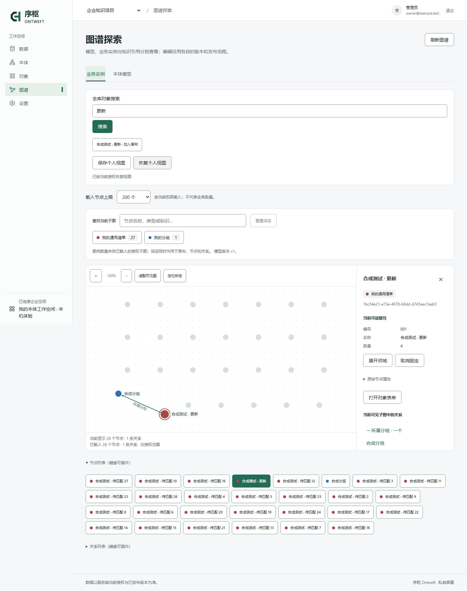

# 序枢 Ontweft

**让知识连接业务。** 一个可编辑、可运行的企业本体工作台：从业务问题出发，定义类型、字段和具名关系，经版本化校验与发布，建立自己的对象和图谱。

**状态：源码 Alpha。** 本机建模闭环已实测；这不是生产就绪或完整企业集成的发布承诺。界面以中文为主。



## 现在可以做什么

- 上传 CSV/XLSX 或选择已发现的数据库资源，生成可编辑的类型与来源映射，发布后导入对象；保留原文件、行号和来源证据。[用自己的数据建模](docs/data-to-ontology.md)
- 按已发布关系及两侧字段预览精确匹配，确认后批量建立实际连线；报告缺失、歧义和基数冲突，保留已有关系。
- 从“项目与任务”“资产与位置”模板或空白开始，自定义类型、属性、枚举和关系。
- 保存变更集、校验、批准并发布模型；按模型创建对象，通过表单编辑并持久保存。
- 查看模型图、实例图和知识引用图；筛选、缩放、选择具名有向关系，区分平行、反向和自引用关系。
- 使用项目角色及字段权限、版本基线保护、知识修订与引用、审计和后台任务。
- 阅读并开发数据库连接、来源映射、CDC、飞书、文档处理、动作与可信函数模块；这些模块各有配置及验收限制。

## 本机启动

需要 **Python 3.12、uv、Node.js 22.12+**。已在 Windows 上验证锁定安装与浏览器闭环；其他系统尚待验证。

```sh
git clone https://github.com/xiaohuihuiaijia/ontweft.git
cd ontweft
uv sync --locked --extra dev
npm --prefix frontend ci
npm --prefix frontend run build
uv run --locked --extra dev python scripts/start_local_demo.py
```

首次启动设置至少 12 个字符的密码，终端不回显。打开 **http://127.0.0.1:8020**，用户名 `owner`。

在“本体模型 → 新建变更集”选择模板，编辑后依次保存、验证、批准、发布；然后到“业务对象”创建记录和关系，在“图谱探索”中查看和继续编辑。[完整入门步骤](docs/getting-started.md) · [本体构建方法论](docs/ontology-methodology.md)

数据保存在 `var/local-demo/`，重启保留账号与数据；不用数据库账号或 AI Key。已有非体验数据目录不会被接管或重置。此入口只监听回环地址，**不用于公网生产部署**。核心建模和图谱不需要 worker；后台任务另开终端：

```sh
uv run --locked --extra dev python scripts/start_local_demo.py worker
```

上传表格不需要开放网络来源。连接自己的 PostgreSQL/MySQL 时，须为服务和 worker 指定相同的来源主机名单；本机或内网地址另需明确启用。见 [数据库接入步骤](docs/data-to-ontology.md#连接自己的数据库)。

## 架构与源码

| 目录 | 内容 |
| --- | --- |
| `backend/ontology` | Python / FastAPI 模块化后端、SQLAlchemy、权限与业务合同 |
| `backend/migrations` | PostgreSQL 的 Alembic 迁移 |
| `backend/tests` | 按领域组织的测试；外部服务用例需显式配置 |
| `frontend/src` | React / TypeScript 工作台，Sigma / Graphology 图谱 |
| `integrations/debezium` | 自有 Java CDC 适配代码、协议样本和测试；没有预构建镜像 |
| `scripts` | 本机体验、验证、可配置开发工具 |
| `docs` | 入门、建模方法、图谱与 Alpha 限制 |

生产存储设计使用 PostgreSQL；SQLite 是独立学习和测试路径，不等同于 PostgreSQL RLS 验收。历史迁移和已发布函数的哈希载体需要保持稳定，见 [贡献说明](CONTRIBUTING.md)。

## 已知限制

- 关系匹配是用户确认的一次性操作，不持续自动重连；尚未提供跨文件更新与身份合并。每次上传是独立来源，不根据同名字段自动连边。
- 尚未实现完整 OWL/SHACL、通用推理、跨对象唯一约束、任意自然语言查询或完整向量/混合检索。
- 飞书实际员工导入/外发、完整来源细粒度治理、部分 CDC 恢复流程及复杂文档/OCR 仍需实现或独立配置验收。可选模型不会因源码发布自动获得授权。
- 图谱单次最多 500 节点、1000 关系；查找只覆盖当前已载入的授权子图。邻域分页、固定节点及生产规模压测尚未完成。
- 模型审批允许具有相应权限的同一用户完成；Action 的异人审批是不同机制。
- 不提供生产可用性、安全审计、商标清查或完整第三方二进制/模型分发通过的声明。

详见 [Alpha 范围与验证](docs/alpha-status.md)。未实现项不是隐式启用的功能。

## 开发与验证

```sh
uv run --locked --extra dev python scripts/test_backend.py backend/tests -q
npm --prefix frontend test -- --maxWorkers=2
npm --prefix frontend run build
```

图谱和入门的真实浏览器验证需要单独安装 Playwright/Chromium，详见 [开发验证](CONTRIBUTING.md)。测试只使用合成数据；不要提交 `.env`、`var/`、客户原件或访问凭据。

## 许可证与来源

自有代码采用 [Apache-2.0](LICENSE)，版权声明见 [NOTICE](NOTICE)。第三方包继续适用各自许可证；前端通知保存在 [THIRD_PARTY_NOTICES.txt](frontend/public/THIRD_PARTY_NOTICES.txt)，构建时从锁定安装包重新生成。

本仓库发布自有源码和必要通知，不捆绑 Python wheels、JAR、Docker 镜像、第三方源码下载树、模型权重或开发数据库。运行依赖由包管理器根据锁文件获取；这不表示其模型或二进制分发义务已全部核清。研究来源与依赖范围见 [第三方说明](third_party/README.md)。

问题与功能建议请提交 [Issue](https://github.com/xiaohuihuiaijia/ontweft/issues)；安全问题按 [SECURITY.md](SECURITY.md) 私下报告。
