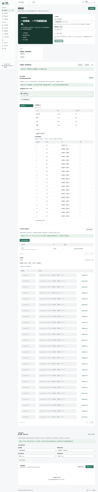
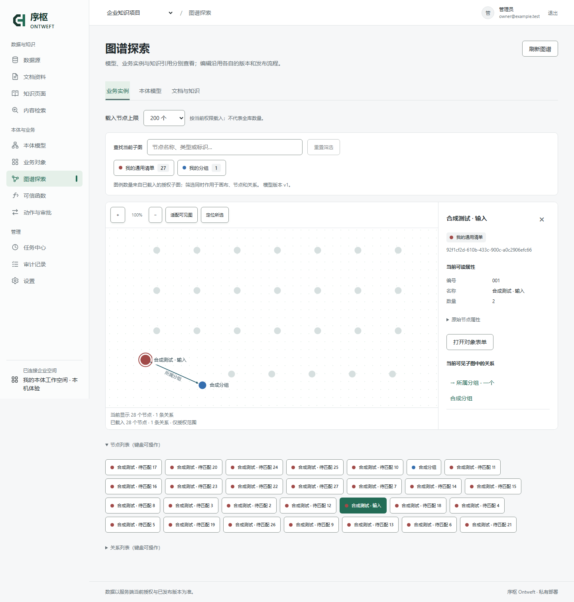

# 从自己的数据建立本体

支持两条入口：CSV/XLSX 和数据库结构可用本地规则生成模型建议，无需 AI Key；文档理解与业务目标驱动的 AI 起草需要管理员配置模型连接。两条路径都产生可编辑建议，由了解业务的人确认后使用既有发布、导入流程，不把输入文件直接认定为正确的业务本体。

## 最短可用路径

1. 按 README 启动页面，另开终端运行 `uv run --locked --no-dev python scripts/start_local_demo.py worker`。自定义目录时两端使用同一个 `--data-dir`。
2. 打开“数据”，选择 CSV 或 XLSX，点击“上传并查看数据”。数据库则先登记连接、测试和发现资源。
3. 查看原列名、数据类型与原始样本。CSV 可明确选择 UTF-8、GB18030 或 UTF-16，以及逗号、分号或制表符。编码不匹配会报错，不会自动丢弃坏行。
4. 首次采集前，在“文件版本与持续更新”为每张表选择明确业务键，再生成可编辑建议。可以一次选多张工作表；不会自动保存草稿、发布或创建对象。
5. 点击“编辑模型与来源映射”，填写变更名称，修改类型显示名称、业务定义、字段类型和映射。已有发布类型与映射会一起保留。来源维护字段继续由数据源管理；可添加人工维护的备注等字段。
6. 保存草稿 → 验证 → 批准当前修订 → 发布。企业模式由当前修订作者之外的审核者批准；数据量较大的模型校验通过后台任务执行。发布基线变化时会拒绝旧草稿，不能覆盖他人的新发布版。
7. 关闭编辑器，在下方选择已映射资源并点击“采集所选资源快照”。每张表分别采集；任务由真实 worker 执行。刷新状态，确认完成及“对象投影：新增 / 更新 / 未改变”的实际计数。
8. 在“对象”查看数据，在“图谱”核对对象与字段。刷新页面后数据仍在。无匹配发布映射的快照只保存原始记录，不会建立对象。
9. 需要跨类型关联时，在模型中定义并发布关系；然后使用“数据 → 确认规则，再建立关系”，选择起点类型、关系及两侧匹配字段。可预览并一次建立，或保存为持续规则自动维护关系。



## 连接自己的数据库

本机入口默认不允许访问网络来源。已有工作空间无需重建；停止服务和 worker 后，使用同一数据目录重新启动即可。以下例子只放行本机数据库：

```sh
uv run --locked --no-dev python scripts/start_local_demo.py --source-host 127.0.0.1 --allow-private-sources
```

另开终端，以同样的来源配置运行 worker：

```sh
uv run --locked --no-dev python scripts/start_local_demo.py worker --source-host 127.0.0.1 --allow-private-sources
```

`--source-host` 填主机名或 IP，不含协议、端口和路径；可重复指定多个明确主机。内网、回环和其他非公网地址需要 `--allow-private-sources`，它不会绕过主机名单，也不会把页面服务暴露到公网。公网来源通常无需这个额外参数。主机配置只作用于本次进程，重启时仍需传入；不读取已有开发 `.env` 或接管其他数据库。

在页面点击“登记数据源”，选择 PostgreSQL，填写名单中的主机、数据库端口、库名、只读账号、独立密码字段和 Schema 范围。MySQL 需要安装并启用 integrations 扩展。密码不用放进启动命令。依次测试连接、发现资源、读取样本，再按上方建模步骤操作。没有声明主键的表可以采样，但不会伪造稳定身份用于对象导入。

关系匹配发生在对象导入之后。数据库已声明的外键可供参考，但仍需确认业务关系及两侧字段。重新采集同一数据库资源时，按来源主键更新原对象并保留人工字段；它与“再次上传一个独立文件”的身份行为不同。

字段建议依据声明类型：整数、精确十进制、布尔、日期、JSON/数组保留对应结构；带时区时间戳建议为时间字段，无时区时间继续保存为文本，不假设来源时区。UUID 保留文本。仍需检查实际样本，尤其是自定义数据库类型、单位和业务编码。

## 建模时需要确认什么

| 决策 | 系统提供什么 | 你需要确认什么 |
| --- | --- | --- |
| 业务边界 | 每张资源一个候选类型 | 是否应合并、拆分，是否回答实际业务问题 |
| 名称与含义 | 原始表名和列名 | 用业务名称替换技术名称，明确概念与反例 |
| 字段类型 | 上传全表的保守建议或来源声明类型 | 编码是否应保留文本，数值单位、日期含义、枚举范围 |
| 对象身份 | 来源声明主键或显式文件业务键；行号只定位原件 | 是否用已发布唯一键精确绑定已有对象；不会自行认定同编号就是同对象 |
| 数据来源 | 原文件摘要、结构指纹、快照、记录坐标 | 哪些来源可信，谁可查看和管理 |
| 业务关系 | 来源外键作为设计依据；显式字段匹配的预览与批量写入 | 关系名称、方向、目标、基数与匹配规则；未解决记录不猜测目标 |
| 约束 | 类型、必填、组合唯一键和关系基数；发布前校验 | 唯一组合和关系基数是否符合业务事实 |

上传建议不会因为某列在当前文件中没有重复就设置唯一约束，也不会根据相似名称创造业务关系。识别到名称、标题类列时使用其作为对象名称；其余标识与标签均可在模型编辑器中检查。更改已被映射或对象引用的稳定标识需要同步修订引用，不能当成普通改名。

## 保留数据的规则

- 原文件按字节保存，记录 SHA-256。只有拥有当前项目来源管理权限的用户可以下载；跨租户请求不可见。
- 规范化表格独立于原文件保存并校验摘要。源记录保留 `_source_row`；XLSX 为工作表行号，含多行引号的 CSV 为记录结束的物理行号。空白行被统计，不会重排行号。
- CSV 原始文本保留前导零和空格；空单元格归为缺失。整数与十进制建议不改变原值，发布映射显式转换后才生成类型化属性。超出 JavaScript 安全范围的整数按现有 API 规则返回精确文本。
- XLSX 读取单元格存储值，日期规范化为 ISO 文本；纯零补位格式保留补位编号。公式按文本处理且提示数量，不计算公式、不请求外链；宏、数组/数据表公式、错误结构与超预算输入被拒绝。复杂 Excel 显示格式不会完整重现，Excel 已经丢失的数值精度不能恢复。
- 文件必须有非空、互不重复的列名以及数据行；不支持跳过错误工作表后部分成功。每次上传最多 10 MiB、32 张表、每表 10,000 数据行/200 列、总计 200,000 单元格，展开预算 64 MiB。多余格式化区域可能超过实际坐标预算，需要先清理源文件。
- 原文件版本不可变。同一来源重复采集或上传新版按业务键更新身份，人工字段保留。默认新增／更新，完整替换需要明确选择并通过完整快照验证。页面顶部独立上传仍创建新来源，不自动合并；跨来源绑定需要显式配置唯一键。

## 当前边界

这是“数据 → 可编辑模型 → 有来源证据的对象 → 持续或人工关系”入口。同来源文件版本和跨来源精确键绑定已实现；复杂历史对象合并仍不在当前范围。旧行号身份来源的兼容迁移见 [企业 Beta 说明](enterprise-beta.md)。关系定义、匹配候选和实际实例连线仍是不同状态。

### 文档理解与 AI 本体起草

PDF、DOCX、XLSX、PPTX、PNG/JPEG、CSV、文本/Markdown 可进入核心文档流程；文档上传默认上限为 256 MiB，与上面的确定性表格接入预算分别适用。原生文字、表格和单元格先在本地读取，PDF 分页渲染、复杂版面及图像由所配置的视觉模型处理，不要求部署 OCR、GPU 或本地模型。

1. 在“设置 → 模型连接”配置兼容服务、允许使用的模型及场景，完成连接能力测试。
2. 在数据工作台选择文件、页面范围，或选择已发现的 PostgreSQL 资源；填写业务要求可定向起草，不填写则自动归纳材料。
3. 系统先读取全部所选页面，再结合目标与已有定义起草模型，最后按模型提取实例和关系候选。查看原文、页面进度和候选。点击证据定位原页；校正类型、属性、关系、业务键与待复核项。新的业务要求复用已有基础识别结果，模型或解析配置改变则建立新版本。
4. 采纳模型建议进入既有变更集，经校验、审批和发布后，再确认导入实例。入口会说明未满足的前置条件；只有实例变化且已有映射可用时无需新建模型变更集。关系必须具有匹配端点和来源证据；没有完整业务键的候选默认不选中，部分解析不推断删除，也不覆盖人工贡献。

PostgreSQL 起草使用结构、主外键与受控样本，正式数据仍按确定性快照及映射采集，不逐行调用模型。文档提案只使用本次已处理页面的材料；页面失败或预算不足时保留进度，不把抽样完成写成整本成功。模型输出的引文可定位不等于业务事实已经正确，复杂规格、单位、条件及跨页关系仍须审阅；远距离关联和真实识别质量以实际测试为准。

### 批量关系如何确认

先发布起点类型上的关系定义及目标类型，然后选择两侧可读、类型兼容的标量字段。匹配范围是当前项目所选类型的全部有效对象，每侧最多 10,000 个；超预算会拒绝，不能静默只处理前一部分。

预览分类列出可建立、已有、缺值、未找到、多个目标同值、自引用未启用、单目标基数冲突。统计覆盖本次范围，匹配样本最多展示 25 条；全部未解决记录可按每页 25 条查看。翻页重新核对权限及同一预览基线，数据变化则要求重新预览，避免混读不同版本。文本精确匹配，不删除空格、不折叠大小写、不把 `001` 当作 `1`；十进制比较不经过浮点数。目标存在重复值时不会任取一个，即使关系允许多个目标，也须先明确业务含义。JSON 字段不作为隐式匹配键。

默认存在未解决记录时不执行。用户可明确勾选“仅建立唯一匹配关系”；只有无歧义且符合关系基数的候选被写入，其余保留。已有手工关系不删除、不覆盖。单类型自引用需另外启用。

确认执行会在同一写事务中重新核对权限、发布版本、对象修订、字段值及已有关系；预览过期则拒绝整批写入并要求重新预览。重新预览后重复执行不会重复建边。审计事件 `relations.matched` 保留规则、确认范围和新关系对应的两端对象修订，可结合对象修订与来源贡献追溯依据。关系自身的知识引用 `evidence` 仍遵循原有合同，不塞入伪造的文档引用。

上面的“确认执行”是一次性关联，后续字段变化不会自动重连。选择“保存为持续规则”才会维护规则自己的关系贡献，并在字段变化后增量重算；保留人工关系及其他来源支持，冲突时暂停受影响记录。两种模式均不提供模糊匹配、隐式单位换算或复杂历史对象合并。

下面是合成验证数据的实际图谱：27 条上传记录、1 个目标对象和 1 条经确认建立的关系。其余记录尚未匹配，保留为独立节点；布局不补造连接。



生产使用还需要相应部署、来源授权与恢复验证。企业模式默认异人模型审批；本机学习入口保留单人操作。具体边界见 [企业 Beta 验证记录](beta-verification.md)。

## 开发验证

```sh
uv run --locked --extra dev python scripts/test_backend.py backend/tests/sources/test_tabular.py backend/tests/sources/test_intake.py backend/tests/sources/test_ingestion.py -q
npm --prefix frontend test -- --maxWorkers=2
npm --prefix frontend run build
node scripts/verify_table_intake.cjs
uv run --locked --extra dev python scripts/verify_model_starters_postgres.py --include-intake
uv run --locked --extra dev python scripts/verify_model_starters_postgres.py --include-relations
uv run --locked --extra dev python scripts/verify_model_starters_postgres.py --include-database-intake
```

浏览器脚本另需 Playwright/Chromium；创建一次性账号、临时数据库与实际后台 worker，使用合成数据，结束后停止自己的进程并清理测试目录。证据写入忽略的 `var/reports/enterprise-beta-browser/`。PostgreSQL 脚本需要 Docker 及已有 `postgres:17` 镜像，使用隔离容器与受限角色；不读取开发凭据。

实现为自有代码，复用已登记的 openpyxl、defusedxml、FastAPI、React 等依赖，未复制外部应用源码。确定性表格接入不调用模型；AI 文档理解与起草使用管理员配置的外部服务，按供应商规则计费。第三方包保持原许可证。
